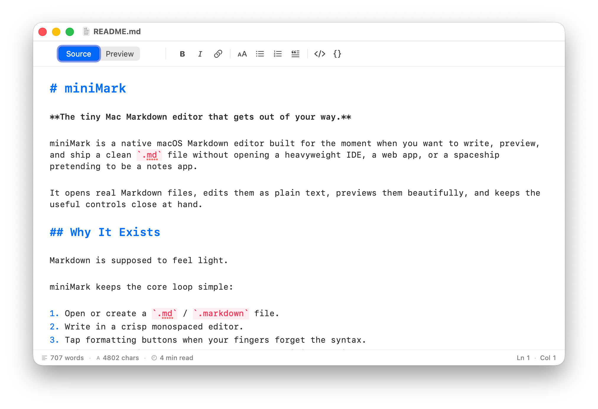
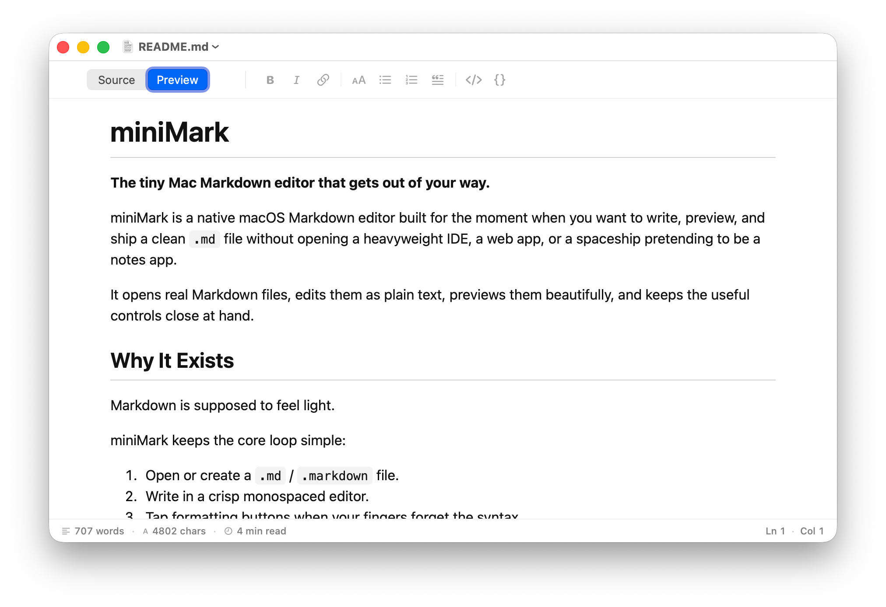

# miniMark

**The tiny Mac Markdown editor that gets out of your way.**

miniMark is a native macOS Markdown editor built for the moment when you want to write, preview, and ship a clean `.md` file without opening a heavyweight IDE, a web app, or a spaceship pretending to be a notes app.

It opens real Markdown files, edits them as plain text, previews them beautifully, and keeps the useful controls close at hand.

## Screenshots

| Source | Preview |
| :---: | :---: |
|  |  |
| Syntax-aware editing in a crisp monospaced source view. | Live preview with code highlighting and copy buttons. |

## Why It Exists

Markdown is supposed to feel light.

miniMark keeps the core loop simple:

1. Open or create a `.md` / `.markdown` file.
2. Write in a crisp monospaced editor.
3. Tap formatting buttons when your fingers forget the syntax.
4. Switch to Preview when you want to see the finished thing.
5. Save a normal Markdown file you can use anywhere.

No account. No workspace lock-in. No mystery format.

## Features

- **Native macOS document app** using SwiftUI `DocumentGroup`
- **Plain-text Markdown editing** for `.md` and `.markdown` files
- **Source and Preview modes** with a compact segmented switcher
- **Syntax-aware source styling** for headings, lists, quotes, links, emphasis, inline code, and fences
- **Markdown preview** powered by MarkdownUI
- **Code block highlighting** powered by Highlightr
- **Copy button on preview code blocks**
- **Formatting toolbar** for bold, italic, links, headings, lists, quotes, inline code, and code blocks
- **Live document stats** for words, characters, line, and column
- **Relative image/link support** in preview based on the opened file location
- **Release DMG script** for local packaging

## The Vibe

miniMark is intentionally small.

It is not trying to be your second brain, your publishing platform, your task manager, or a database with a text box attached. It is a fast little writing surface for Markdown files that should stay portable.

## Requirements

- macOS 14.0 or newer
- Xcode with Swift support

Swift Package dependencies are resolved through the Xcode project:

- `swift-markdown-ui` 2.4.1+
- `Highlightr` 2.3.0+

## Build

Open the project in Xcode:

```sh
open miniMark.xcodeproj
```

Then select the `miniMark` scheme and run.

You can also build from the command line:

```sh
xcodebuild \
  -project miniMark.xcodeproj \
  -scheme miniMark \
  -destination "platform=macOS" \
  build
```

## Test

```sh
xcodebuild \
  -project miniMark.xcodeproj \
  -scheme miniMark \
  -destination "platform=macOS" \
  test
```

The test suite currently covers document encoding/decoding, formatting behavior, preview helpers, and document stats.

## Package A DMG

```sh
./scripts/build_dmg.sh
```

That creates:

```text
build/miniMark.dmg
```

The script builds the release app, stages it with an `/Applications` shortcut, and creates a compressed disk image.

For release builds, the script also accepts CI-friendly overrides:

```sh
RELEASE_VERSION=0.1.0 \
BUILD_NUMBER=42 \
OUTPUT="$PWD/build/miniMark-0.1.0.dmg" \
./scripts/build_dmg.sh
```

## GitHub Releases

Releases are published by `.github/workflows/release.yml` when a version tag is pushed:

```sh
git tag v0.1.0
git push origin v0.1.0
```

The workflow resolves Swift packages, runs the test suite, builds a signed and notarized versioned DMG, and attaches it to a GitHub Release with generated release notes.

You can also run the workflow manually from GitHub Actions and provide a tag such as `v0.1.0`.

Before publishing releases, add the Apple Developer details in the GitHub website:

1. Open the repo on GitHub.
2. Go to **Settings > Secrets and variables > Actions**.
3. Add repository variables:

```text
APPLE_TEAM_ID=ABCDE12345
DEVELOPER_ID_APPLICATION=Developer ID Application: Your Name or Company (ABCDE12345)
```

4. Add repository secrets:

```text
APPLE_ID=you@example.com
APPLE_APP_SPECIFIC_PASSWORD=xxxx-xxxx-xxxx-xxxx
DEVELOPER_ID_CERTIFICATE_PASSWORD=your-p12-password
DEVELOPER_ID_CERTIFICATE_BASE64=base64-encoded-developer-id-application-p12
```

To create `DEVELOPER_ID_CERTIFICATE_BASE64`, export your Developer ID Application certificate from Keychain Access as a `.p12`, then run:

```sh
base64 -i DeveloperIDApplication.p12 | pbcopy
```

Paste the copied value into the GitHub secret.

## Project Map

```text
miniMark/
  App/          App entry point and AppKit delegate
  Document/     Markdown file types and file document model
  Editor/       NSTextView-backed source editor and syntax styling
  Formatting/   Markdown formatting commands
  Preview/      MarkdownUI preview and Highlightr integration
  Stats/        Word, character, line, and column stats
  UI/           Main document view and formatting toolbar

miniMarkTests/  Unit tests
scripts/        Icon and DMG helpers
```

## Design Notes

miniMark uses an `NSTextView` inside SwiftUI for the editor because Markdown editing benefits from mature macOS text behavior: undo, find, spellcheck, selection handling, and native keyboard feel.

Preview rendering is debounced so typing stays responsive while the rendered view still catches up quickly. Code highlighting is normalized for common language aliases like `js`, `ts`, `sh`, `objc`, and `c++`.

## Roadmap Ideas

- Export preview to HTML or PDF
- Toggleable side-by-side editor and preview
- Theme picker for source and preview
- Markdown table helper
- Front matter awareness
- Word goal / reading time

## Contributing

Keep MiniMark small, fast, and honest.

Good contributions should preserve the plain-file workflow, avoid lock-in, and make writing Markdown feel calmer. Focused fixes and thoughtful little features are very welcome.

## License

MiniMark is released under the MIT License with the Commons Clause License
Condition v1.0. See [LICENSE](LICENSE).
