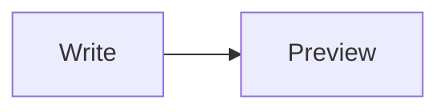

# App Store listing (miniMark 1.0)

Every claim below is something the build does. Character limits are Apple's; counts were measured.

| Field | Value | Count |
|---|---|---|
| Name | miniMark (fallback: miniMark: Markdown Editor) | 8 / 30 (fallback 25) |
| Subtitle | Tiny, native Markdown editor | 28 / 30 |
| Promotional text | Write in plain text, flip to a clean preview, export when it is ready. Tables, task lists, footnotes, math and diagrams. miniMark collects nothing. | 147 / 170 |
| Keywords | `md,preview,mermaid,latex,math,footnotes,tables,readme,docs,notes,writer,export,pdf,rtf,diagram` | 94 / 100 bytes |
| Primary / secondary category | Productivity / Developer Tools | matches Info.plist |
| Support URL | https://ideius.com/minimark/support/ | |
| Privacy policy URL | https://ideius.com/minimark/privacy/ | |
| Marketing URL | https://ideius.com/minimark/ | |
| Copyright | needs the legal name to show (owner) | |
| Age rating | answer the questionnaire; expected 4+ (no restricted content, not a browser) | |
| App Privacy | Data Not Collected | |
| Export compliance | no non-exempt encryption (Info.plist already says so) | |
| Price | launch price, then $4.99 (the owner's plan) | |
| Screenshots | 2880x1800, no transparency: source and preview, light and dark | from the app's own snapshot mode |

Policy checks applied: no other apps' names or trademarks in any field (2.3.7); no price, no "free" or "new" wording in the name or subtitle; screenshots show the app in use (2.3.3); no hidden features, so the screenshot mode is compiled out of the store build (2.3.1); keywords do not repeat words already in the name or subtitle.

## Description (1265 / 4000)

miniMark is a small, native Markdown editor for the Mac. It opens ordinary .md and .markdown files, lets you edit them as plain text, and shows a clean rendered preview whenever you want one.

WRITE IN PLAIN TEXT
• Source mode styles headings, lists, quotes, links, emphasis, inline code and code fences as you type
• A toolbar for bold, italic, links, headings, lists, quotes, inline code and code blocks
• Live counts for words, characters, reading time, line and column

READ IT RENDERED
• Press Shift-Command-P to flip between Source and Preview
• Tables, task lists, footnotes, strikethrough, links, images and quotes
• LaTeX math with $...$ and $$...$$
• Mermaid diagrams
• Code blocks with syntax highlighting and a copy button
• Pictures stored next to your document appear in the preview

EXPORT WHEN IT IS READY
• Save TXT, RTF or HTML from the File menu
• Print, or save as PDF, from the standard Mac print sheet
• Math and diagrams appear in HTML and PDF; RTF keeps math as its source text

MADE TO STAY OUT OF THE WAY
• Light, dark, or follow your Mac
• Choose whether documents open in Source or Preview
• Your files stay on your Mac, where you save them
• No account, no analytics, no tracking. miniMark collects nothing.

Requires macOS 14 or later.

## Notes for App Review (1229 / 4000 bytes)

miniMark is a document-based Markdown editor. No account or login is needed.

To try it: open any .md file with File > Open (or File > New), press Shift-Command-P to switch between Source and Preview, use File > Export for TXT, RTF or HTML, and File > Print > Save as PDF for a PDF. A sample document that uses every supported feature is below; paste it into a new document.

The app makes no network requests of its own. The preview uses WebKit, which loads a picture from the web only if a document links to one, so the app has the outgoing-connections sandbox entitlement. It also has user-selected file read/write (to open and save documents) and app-scoped bookmarks: when a document refers to pictures in its folder, macOS asks the user once to allow that folder, and the bookmark remembers the choice. The print entitlement is for the standard Print and Save as PDF sheet.

Bundled, local-only code: Mermaid (diagrams), KaTeX (math) and highlight.js (code colours). All rendering libraries are bundled; no library code is downloaded at runtime.

Sample document:

# Release notes
- [x] Task lists
- [ ] Footnotes[^1]
Euler: $e^{i\pi} + 1 = 0$
| A | B |
| - | - |
| 1 | 2 |
```swift
let answer = 42
```

[^1]: A footnote.
