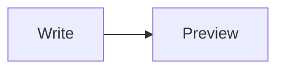

# App Store listing (miniMark 1.0)

Every claim below is something the build does. Character limits are Apple's; counts were measured.

| Field | Value | Count |
|---|---|---|
| Name | miniMark (fallback: miniMark: Markdown Editor) | 8 / 30 (fallback 25) |
| Subtitle | Markdown Editor with Preview | 28 / 30 |
| Promotional text | Open any .md file, write in plain text, and press Shift-Command-P to see it beautifully rendered: math, diagrams, tables and highlighted code. Nothing to set up. | 161 / 170 |
| Keywords | `md,readme,latex,math,mermaid,diagram,notes,writer,text,docs,table,footnote,pdf,export,viewer,code` | 97 / 100 bytes |
| Primary / secondary category | Productivity / Developer Tools | matches Info.plist |
| Support URL | https://ideius.com/minimark/support/ | |
| Privacy policy URL | https://ideius.com/minimark/privacy/ | |
| Marketing URL | https://ideius.com/minimark/ | |
| Copyright | 2026 ideius LLC (the seller name as App Store Connect shows it; Apple adds the ©) | |
| Age rating | Answer the questionnaire: every content and capability question None/No, including social media and, from Nov 16, 2026, Shared Location and Dating and Relationships; expect 4+. The preview cannot browse: clicking a link opens it in the user's default browser, outside the app, so Unrestricted Web Access is No (Apple's definition: users can navigate to any web page within the app or freely browse the web; a judgment, not Apple-confirmed). | |
| App Privacy | App Privacy > Get Started > "No, we do not collect data from this app". Privacy policy link is also in the app: Help > Privacy Policy (5.1.1(i)). | |
| Export compliance | no non-exempt encryption (Info.plist already says so) | |
| Price | Base price $0.99. After the version is submitted, schedule a Global price change to $4.99 starting 30 days after release (Apple allows scheduling only after submission; dates up to the end of next year). No price anywhere in the metadata (2.3.7). | |
| Screenshots | Five 2880x1800 frames, no transparency, in this order: store-1 (tiny Markdown editor), store-2 (plain text you own), store-3 (math, diagrams and tables), store-4 (code), store-5 (day or night; subline says export TXT, RTF or HTML, or print to PDF). Each is a headline over the real app window | from the app's own snapshot mode |

Policy checks applied: no other apps' names or trademarks in any field (2.3.7); no price, no "free" or "new" wording in the name or subtitle; screenshots show the app in use (2.3.3); no hidden features, so the screenshot mode is compiled out of the store build (2.3.1); keywords do not repeat words already in the name or subtitle.

## Description (1334 / 4000)

Markdown should feel light. miniMark is a small, native Mac editor that opens any .md file, lets you write in plain text, and shows it beautifully rendered the moment you press Shift-Command-P.

It is made for READMEs, docs, notes and the Markdown files your tools and AI assistants write, without an IDE, a web app or a notes database in the way.

WRITE IN PLAIN TEXT
• Headings, lists, quotes, links, emphasis and code are styled as you type
• A toolbar for bold, italic, links, headings, lists, quotes and code
• Word, character and reading-time counts, plus line and column

SEE IT RENDERED
• One shortcut flips between Source and Preview
• Tables, task lists, footnotes, strikethrough, links and images
• LaTeX math with $...$ and $$...$$
• Mermaid diagrams
• Code blocks with syntax highlighting and a copy button
• Pictures next to your document show up in the preview

SHARE IT WHEN IT IS READY
• Export TXT, RTF or HTML
• Print, or save as PDF from the standard print sheet
• Math and diagrams come along in HTML and PDF; RTF keeps math as source text

STAYS OUT OF YOUR WAY
• Your files stay ordinary files on your Mac, where you save them
• Light, dark, or follow your Mac
• Choose whether documents open in Source or Preview
• No account, no analytics, no tracking

Requires macOS 14 or later and a Mac with Apple silicon.

## Notes for App Review (1362 / 4000 bytes)

miniMark is a document-based Markdown editor. No account or login is needed.

Help > miniMark Support and Help > Privacy Policy open the support and privacy pages. To try it: open any .md file with File > Open (or File > New), press Shift-Command-P to switch between Source and Preview, use File > Export for TXT, RTF or HTML, and File > Print > Save as PDF for a PDF. A sample document that uses every supported feature is below; paste it into a new document.

The app makes no network requests of its own. The preview uses WebKit, which loads a picture from the web only if a document links to one, so the app has the outgoing-connections sandbox entitlement. It also has user-selected file read/write (to open and save documents) and app-scoped bookmarks: when a document refers to pictures in its folder, macOS asks the user once to allow that folder, and the bookmark remembers the choice. The print entitlement is for the standard Print and Save as PDF sheet.

Bundled, local-only code: Mermaid (diagrams), KaTeX (math) and highlight.js (code colours). All rendering libraries are bundled; no library code is downloaded at runtime.

Sample document:

# Release notes
- [x] Task lists
- [ ] Footnotes[^1]
Euler: $e^{i\pi} + 1 = 0$
| A | B |
| - | - |
| 1 | 2 |
```swift
let answer = 42
```

[^1]: A footnote.
